# SIRH Intelligent — Système d'Information des Ressources Humaines

> Plateforme RH complète avec analyses IA, développée pour ACERFI SARL.  
> Projet de fin d'études — Certification ISA 2026.

**Auteur :** Yemeya Luc  
**Email :** lucyemeya1@gmail.com  
**Entreprise :** ACERFI SARL, Douala, Cameroun

---

## Aperçu

| | |
|---|---|
| 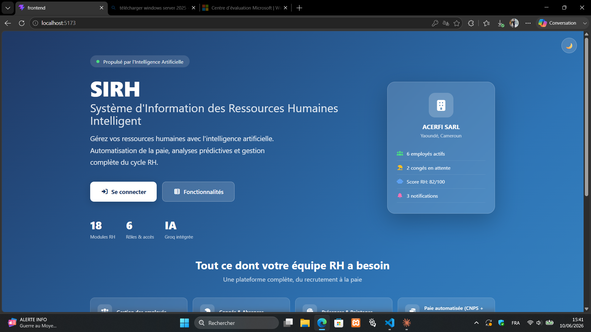 | 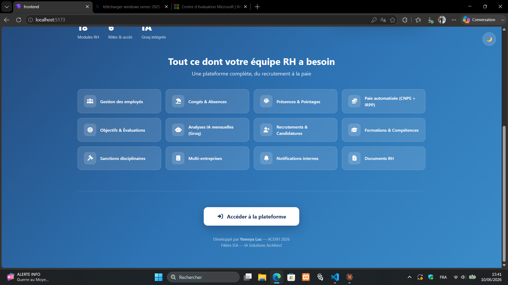 |
| Page d'accueil | 18 modules RH |
| 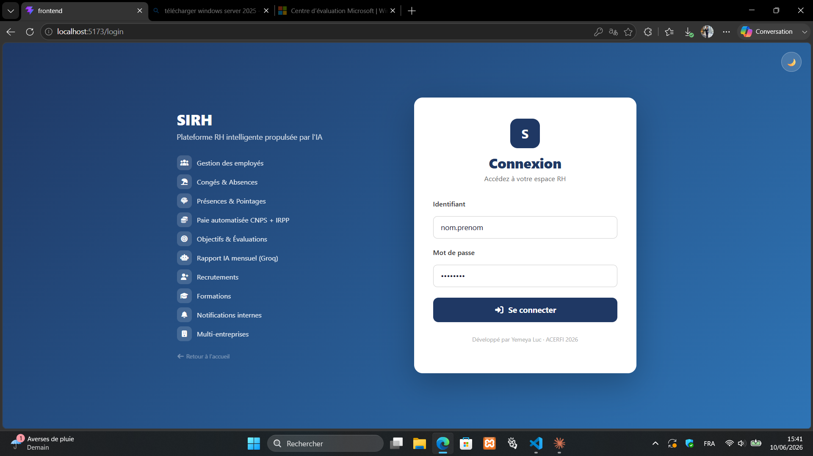 | 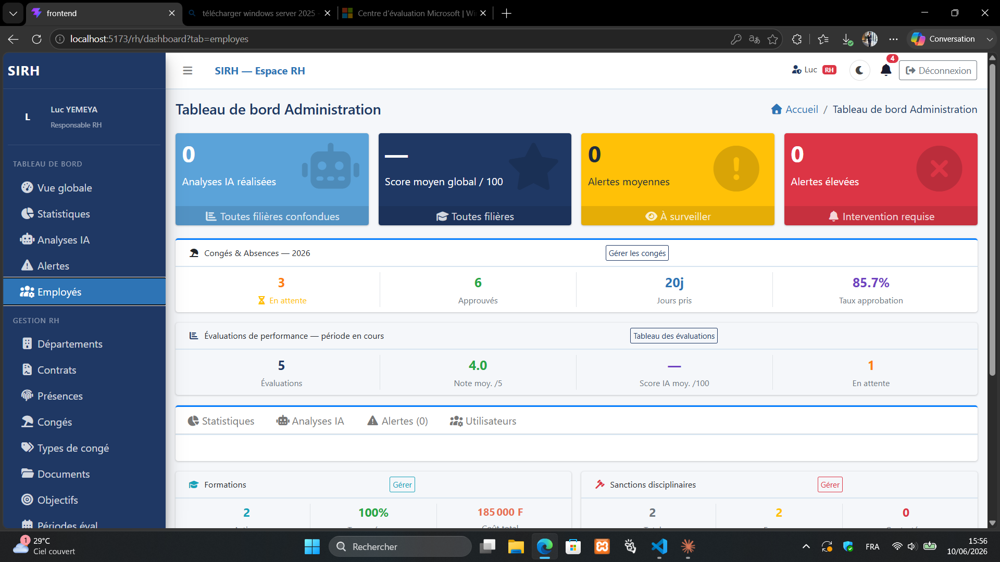 |
| Connexion multi-rôle | Dashboard RH — vue globale |
| 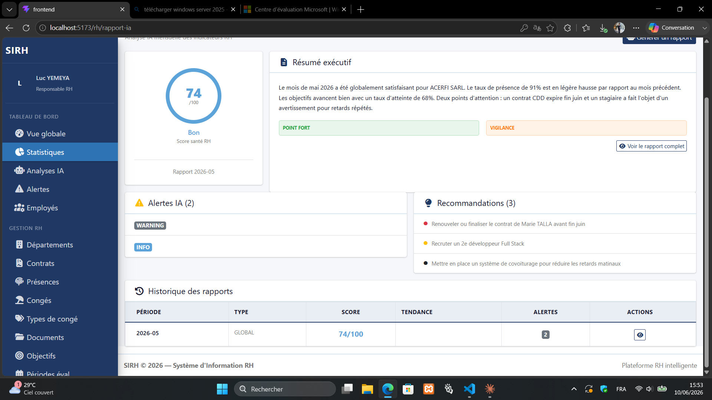 |  |
| Rapport RH mensuel par IA | Historique & recommandations |
| 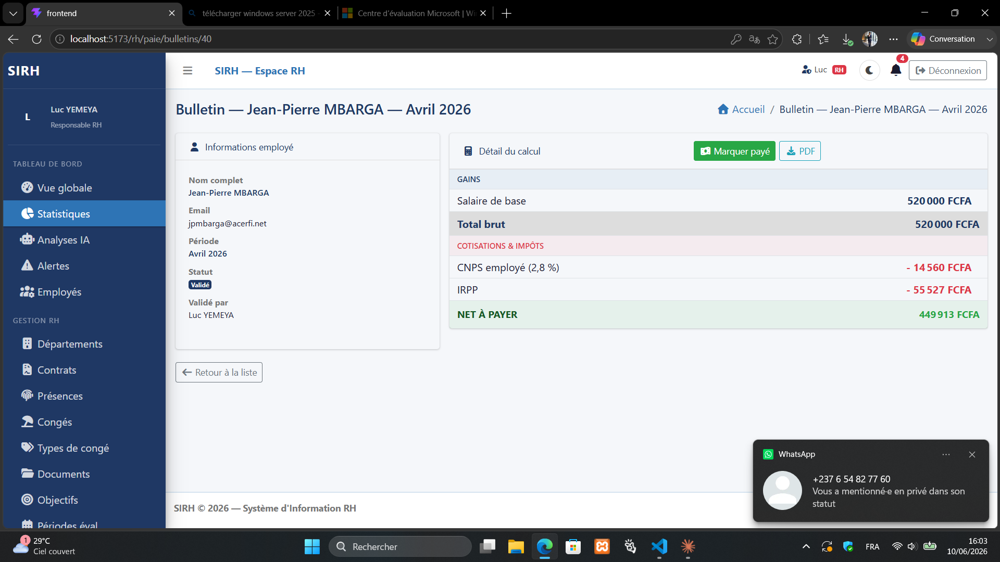 | 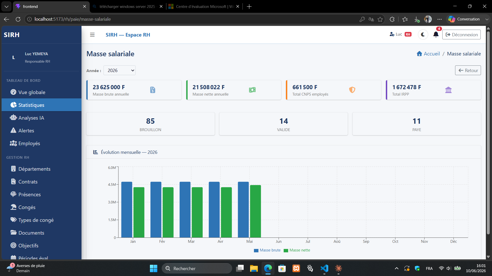 |
| Bulletin de paie (CNPS + IRPP camerounais) | Masse salariale — évolution mensuelle |
| 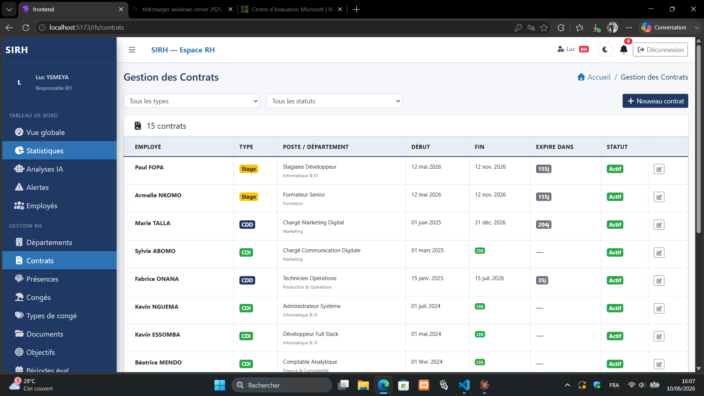 | 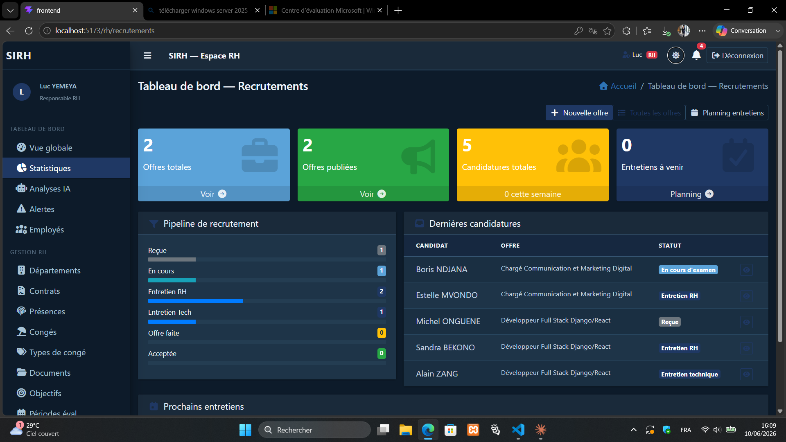 |
| Gestion des contrats | Pipeline de recrutement |
| 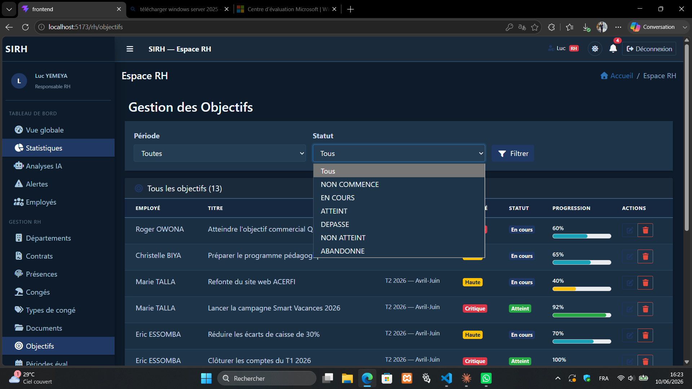 | 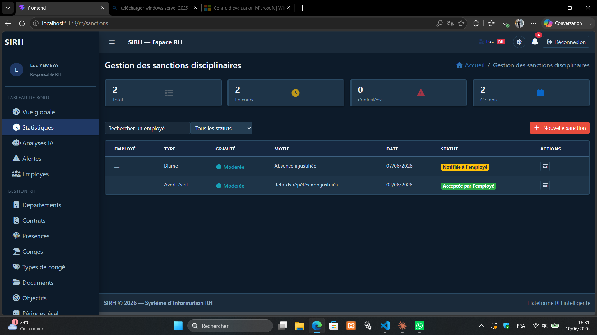 |
| Objectifs & évaluations (mode sombre) | Sanctions disciplinaires (mode sombre) |
| 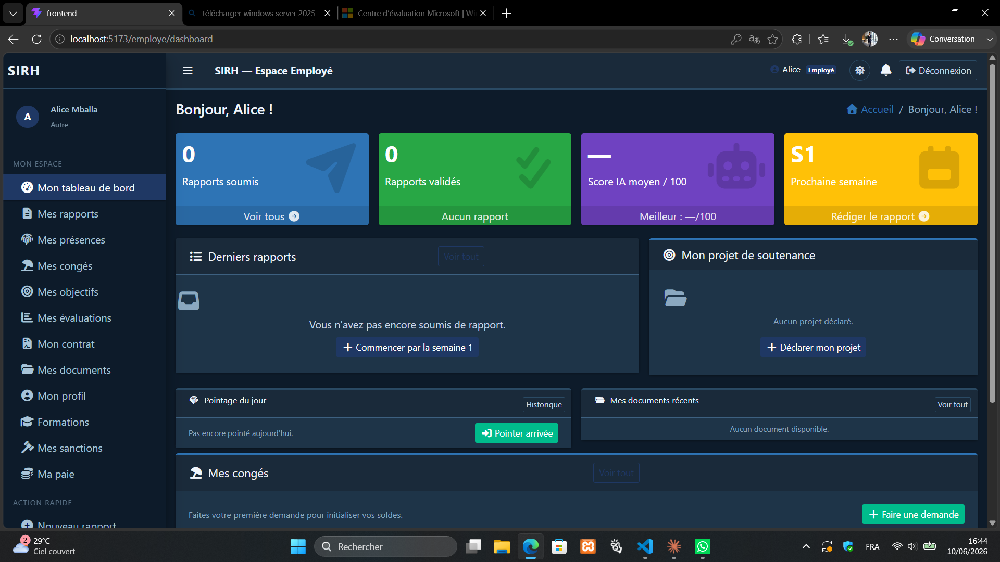 | 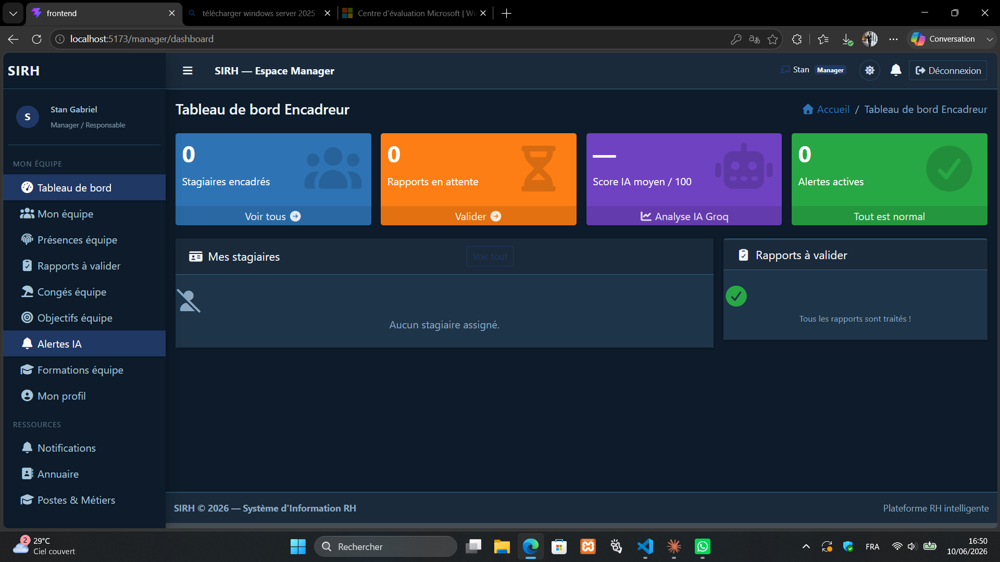 |
| Espace Employé | Espace Manager |

---

## Stack technique

| Couche | Technologie | Version |
|--------|-------------|---------|
| Backend | Django + Django REST Framework | 5.2 |
| Base de données | MySQL (PyMySQL) | 8.4 (Docker) / 9.x |
| Authentification | JWT (simplejwt) | Bearer token |
| Frontend | React + Vite | 19 + 8 |
| UI | AdminLTE + Bootstrap | 3.2 + 4 |
| État global / graphiques | Zustand / Recharts | — |
| IA générative | Google Gemini (SDK `google-genai`), secours OpenRouter, plan B sans IA | `gemini-flash-latest` |
| Déploiement | Docker Compose (MySQL + Django/gunicorn + nginx) | — |

---

## 18 modules fonctionnels

| # | Module | Description |
|---|--------|-------------|
| 1 | Comptes | Utilisateurs avec 4 rôles (EMPLOYE / MANAGER / RH / ADMIN) |
| 2 | Entreprises | Multi-entreprises isolées les unes des autres (logo, couleurs) |
| 3 | Départements | Arborescence organisationnelle + postes |
| 4 | Contrats | CDI / CDD / Stage / Freelance, contrôles légaux, alertes d'expiration |
| 5 | Congés | Droits légaux (art. 89-93 Code du travail), solde contrôlé, jours fériés légaux |
| 6 | Présences | Pointages, heures supplémentaires (décret 95/677/PM) |
| 7 | Documents | Documents RH avec aperçu avant téléchargement |
| 8 | Paie | Bulletins CNPS, IRPP, CAC, CFC, FNE, RAV, TDL (fiscalité camerounaise 2024) |
| 9 | Objectifs | Objectifs SMART et évaluations de performance |
| 10 | Recrutements | Pipeline complet + analyse IA des CV pseudonymisés (lecture PDF / Word) |
| 11 | Formations | Catalogue, inscriptions, compétences |
| 12 | Sanctions | Sanctions disciplinaires (pouvoir disciplinaire : RH) |
| 13 | Carrière | Historique des évolutions de poste |
| 14 | Rapport IA | Rapport mensuel de santé RH (Gemini, plan B par règles hors ligne) |
| 15 | Notifications | Notifications internes automatiques (7 types) |
| 16 | Annuaire | Répertoire des collègues (identité professionnelle uniquement) |
| 17 | Rapports | Rapports d'activité hebdomadaires |
| 18 | Analyse IA | Analyses IA individuelles par rapport |

---

## Démarrage rapide avec Docker

Prérequis : Docker Desktop.

```powershell
docker compose up -d --build
```

Application sur **http://localhost:8080** (MySQL exposé sur le port 3307). Les clés d'IA
et la `SECRET_KEY` sont lues dans `backend/.env` (voir ci-dessous). Pour importer une
base existante, placer un export `.sql` dans `docker/mysql-init/` avant le premier
démarrage.

## Installation manuelle

Prérequis : Python 3.11+, Node.js 20+, MySQL 8+.

```sql
CREATE DATABASE sirh_db CHARACTER SET utf8mb4 COLLATE utf8mb4_unicode_ci;
```

```powershell
cd backend
python -m venv venv
venv\Scripts\activate
pip install -r requirements.txt
```

Créer `backend/.env` :

```env
DB_NAME=sirh_db
DB_USER=root
DB_PASSWORD=
DB_HOST=localhost
DB_PORT=3306
SECRET_KEY=changez-moi
DEBUG=True
ALLOWED_HOSTS=localhost,127.0.0.1
CORS_ALLOWED_ORIGINS=http://localhost:5173
# IA (facultatif : sans clé, le plan B calcule les rapports par règles)
GEMINI_API_KEY=
GEMINI_MODEL=gemini-flash-latest
OPENROUTER_API_KEY=
# Paie : mesures de la loi de finances 2024 suspendues par le MINFI (False par défaut)
PAIE_APPLIQUER_LF2024=False
# Congés : autoriser à puiser dans le droit de l'année en cours
CONGES_ANTICIPATION_AUTORISEE=False
```

```powershell
python manage.py migrate
& "venv\Scripts\python.exe" manage.py shell -c "exec(open('fixtures/populate_demo.py', encoding='utf-8').read())"
python manage.py runserver
```

```bash
cd frontend
npm install
npm run dev
```

Application sur **http://localhost:5173**.

---

## Comptes de démonstration

Comptes créés par `fixtures/populate_demo.py` (mot de passe `Demo2026!`) :

| Rôle | Username |
|------|----------|
| Administrateur | `admin.sirh` |
| Responsable RH | `sophie.nkomo` |
| Manager (département Formation) | `paul.atangana` |
| Employé | `alice.mballa` |
| Employé | `paul.fopa` |

Le script plus léger `fixtures/demo_data.py` crée `admin.rh` (RH) et `manager.it`
(manager IT) — voir le guide d'installation.

---

## Tests et qualité

```powershell
cd backend
python manage.py test accounts entreprises rapport_ia conges paie presences recrutements
```

113 tests automatisés, dont :

| Domaine | Tests | Ce qui est vérifié |
|---|---:|---|
| Paie | 26 | barèmes CNPS, IRPP, CAC, CFC, FNE, RAV, TDL ; bulletin de référence calculé à la main |
| Congés | 32 | droits légaux, jours ouvrables et fériés, solde contrôlé, dérogation RH |
| Présences | 5 | majorations des heures supplémentaires |
| Sécurité | 17 | droits par rôle, données personnelles (loi n° 2024/017) |
| Isolation | 7 | une entreprise ne voit jamais les données d'une autre |
| Plan B IA | 11 | rapports sans Internet, sans clé ou en quota épuisé |
| Recrutement | 15 | lecture des CV (PDF, Word, scanné), pseudonymisation, plan B |

Frontend : `npm run lint` sans erreur ; les 78 pages des trois rôles ont été vérifiées
dans Chrome (aucune erreur JavaScript ni appel API en échec).

---

## Architecture

```
gsria/
├── docker-compose.yml    MySQL + backend (gunicorn) + frontend (nginx)
├── backend/              Django 5.2
│   ├── config/           settings.py, urls.py
│   ├── ia/               client IA centralisé (Gemini, OpenRouter, plan B)
│   ├── entreprises/      isolation entre entreprises (isolation.py)
│   ├── fixtures/         données de démonstration
│   └── <18 apps>/        accounts, contrats, conges, paie, rapport_ia...
├── frontend/             React 19 + Vite
│   └── src/
│       ├── api/          axios.js + un fichier par module
│       ├── components/   layouts, aperçu de documents, hooks partagés
│       ├── pages/        par rôle (rh/, manager/, employe/)
│       └── store/        authStore.js (Zustand)
└── docs/                 documentation technique et fiches de soutenance
```

---

## Documentation

| Document | Description |
|----------|-------------|
| [docs/RAPPORT_TECHNIQUE.md](docs/RAPPORT_TECHNIQUE.md) | Rapport technique complet |
| [docs/BULLETIN_PAIE_PAS_A_PAS.md](docs/BULLETIN_PAIE_PAS_A_PAS.md) | Bulletin de paie calculé ligne par ligne, barèmes et sources |
| [docs/SECURITE_DROITS_ACCES.md](docs/SECURITE_DROITS_ACCES.md) | Matrice des droits, isolation, protection des données |
| [docs/IA_PLAN_B.md](docs/IA_PLAN_B.md) | Fonctionnement de l'IA et plan B hors ligne |
| [docs/DEPLOIEMENT.md](docs/DEPLOIEMENT.md) | Mise en production |
| [docs/GUIDE_INSTALLATION.md](docs/GUIDE_INSTALLATION.md) | Guide d'installation étape par étape |
| [docs/GUIDE_UTILISATEUR.md](docs/GUIDE_UTILISATEUR.md) | Guide utilisateur RH / Manager / Employé |
| [docs/SCRIPT_DEMO_SOUTENANCE.md](docs/SCRIPT_DEMO_SOUTENANCE.md) | Déroulé de démonstration |

---

## Points techniques

- **Isolation entre entreprises** : `entreprises/isolation.py`, appliquée à toutes les vues
  (listes, détails, créations, statistiques, données envoyées à l'IA).
- **IA asynchrone** : `threading.Thread(daemon=True)` ; sans réseau, bascule immédiate
  sur le calcul par règles.
- **Paie camerounaise** : CNPS 4,2 % salarié / 4,2 % + 7 % + 1,75 % employeur (plafond
  750 000), IRPP progressif + CAC 10 %, CFC, FNE, RAV, TDL.
- **Congés** : 1,5 jour ouvrable par mois, majorations légales, dix jours fériés légaux.

---

## Licence

Projet académique — usage éducatif. ACERFI SARL 2026.
